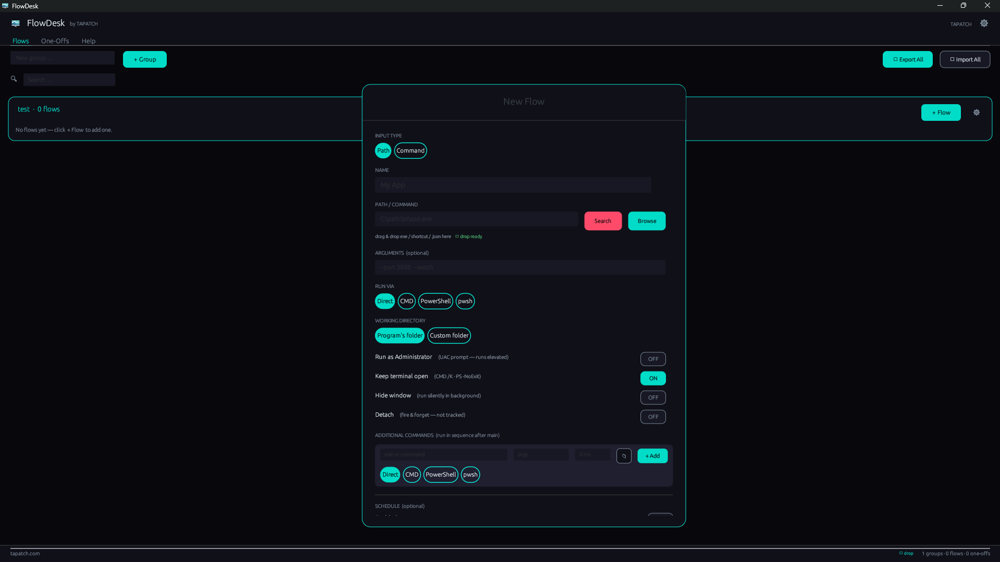

**FlowDesk 1.0.5** for Windows 10/11 (x64) · Free for personal use

### What's new

- Background pictures and GIFs: add as many as you like in Settings, tick the ones to show (or Select all), and the ticked ones take turns
- Sliders set how strong the picture is and how see-through the panels are; turn it off any time
- The installer's license text matches the current Terms, and THIRD-PARTY-NOTICES.txt lists the open-source parts it uses

### Screenshots

### Video

### Download

**`FlowDesk-Setup-1.0.5.exe`** is attached below. It is the same file as on [tapatch.com/tools/flowdesk](https://tapatch.com/tools/flowdesk/).

### Security

- VirusTotal: **1 / 71** engines flag it · [view report](https://www.virustotal.com/gui/file/5fffbdf8162e513bbad89ed293fcf420989e8f6f4144dc635014e641dce5740f/detection)
- SHA-256: `5fffbdf8162e513bbad89ed293fcf420989e8f6f4144dc635014e641dce5740f`

*First released on tapatch.com on 2026-11-04.*

---
Free for personal use. Business or commercial use requires a paid license (see [tapatch.com/terms](https://tapatch.com/terms/)).
