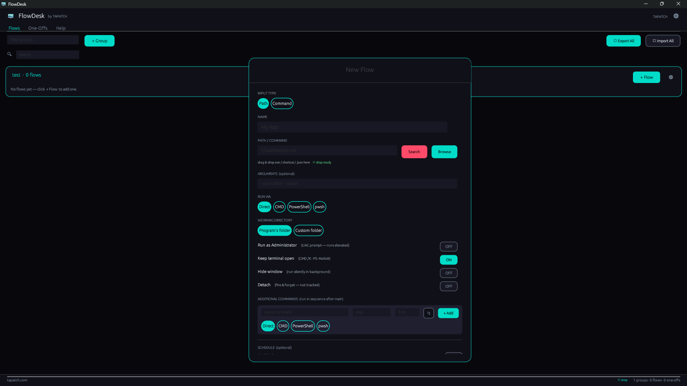

**FlowDesk 1.0.6** for Windows 10/11 (x64) · Free for personal use

### What's new

- Arrows, check marks and other symbols no longer show as empty boxes
- The English text now uses American spelling everywhere

### Screenshots

### Download

**`FlowDesk-Setup-1.0.6.exe`** is attached below. It is the same file as on [tapatch.com/tools/flowdesk](https://tapatch.com/tools/flowdesk/).

### Security

- VirusTotal: **1 / 71** engines flag it · [view report](https://www.virustotal.com/gui/file/d404ca51ceb735d652f3ee57417e1f1f0bc21ce133b3c24c6509a86054c88b3c/detection)
- SHA-256: `d404ca51ceb735d652f3ee57417e1f1f0bc21ce133b3c24c6509a86054c88b3c`

*First released on tapatch.com on 2026-11-07.*

---
Free for personal use. Business or commercial use requires a paid license (see [tapatch.com/terms](https://tapatch.com/terms/)).
